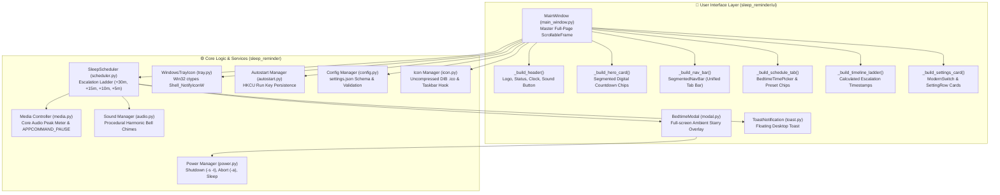

# 🌙 Developer Guide & Code Architecture Map

> A comprehensive visual and technical reference mapping every visible UI component, background engine, and system integration in **Sleep Reminder** to its exact source file, class, and method.

---

## 📑 Table of Contents
1. [Architecture Overview](#1-architecture-overview)
2. [Component Diagram](#2-component-diagram)
3. [Visual UI-to-Code Mapping](#3-visual-ui-to-code-mapping)
   - [3.1 Application Window & Titlebar Branding](#31-application-window--titlebar-branding)
   - [3.2 Top Header & Controls](#32-top-header--controls)
   - [3.3 Segmented Pill Navigation Bar](#33-segmented-pill-navigation-bar)
   - [3.4 Hero Countdown Banner](#34-hero-countdown-banner)
   - [3.5 Bedtime Setup Studio](#35-bedtime-setup-studio)
   - [3.6 Dynamic Escalation Ladder Timeline](#36-dynamic-escalation-ladder-timeline)
   - [3.7 Settings Section & Linear Switches](#37-settings-section--linear-switches)
   - [3.8 Master Full-Page Scrolling Container](#38-master-full-page-scrolling-container)
   - [3.9 Sleep Cycles (REM) Tab](#39-sleep-cycles-rem-tab)
   - [3.10 Habit Streak & Stats Tab](#310-habit-streak--stats-tab)
   - [3.11 Full-Screen Ambient Reminder Modal](#311-full-screen-ambient-reminder-modal)
   - [3.12 Toast Notification](#312-toast-notification)
   - [3.13 Windows System Tray Icon](#313-windows-system-tray-icon)
4. [Backend Services & Subsystems](#4-backend-services--subsystems)
   - [4.1 Escalation Scheduler Engine](#41-escalation-scheduler-engine)
   - [4.2 Smart Video & Media Pause Engine](#42-smart-video--media-pause-engine)
   - [4.3 Windows Power Management Actions](#43-windows-power-management-actions)
   - [4.4 Procedural In-Memory Audio Synthesizer](#44-procedural-in-memory-audio-synthesizer)
   - [4.5 Windows Startup (Autostart) Subsystem](#45-windows-startup-autostart-subsystem)
   - [4.6 Configuration & Persistence](#46-configuration--persistence)
   - [4.7 Multi-Resolution Icon Generator](#47-multi-resolution-icon-generator)
5. [Data Flow & Lifecycle](#5-data-flow--lifecycle)
6. [Developer Recipes: How to Extend](#6-developer-recipes-how-to-extend)

---

## 1. Architecture Overview

Sleep Reminder is designed with **strict zero-dependency principles**, running entirely on the standard Python library (`tkinter`, `ctypes`, `winsound`, `winreg`, `struct`, `zlib`) on Windows.

```
┌────────────────────────────────────────────────────────────────────────┐
│                               main.py                                  │
│           (Initializes AppUserModelID, bootstraps run())               │
└───────────────────────────────────┬────────────────────────────────────┘
                                    │
                                    ▼
┌────────────────────────────────────────────────────────────────────────┐
│                        sleep_reminder/app.py                           │
│  • ConfigManager  • HistoryManager  • SoundManager  • Autostart Setup  │
└───────────────────────────────────┬────────────────────────────────────┘
                                    │
          ┌─────────────────────────┴─────────────────────────┐
          ▼                                                   ▼
┌───────────────────────────────┐           ┌───────────────────────────────┐
│          UI Layer             │           │        Engine Services        │
│ • MainWindow (Full-page)      │◄─────────►│ • SleepScheduler (Thread)     │
│ • BedtimeModal (Full-screen)  │           │ • WindowsTrayIcon (Win32 HWND)│
│ • ToastNotification (Popup)   │           │ • pause_system_media (CoreAud)│
│ • Components (Switches/Pills) │           │ • PowerManager (Shutdown/Sleep│
│ • Theme & Midnight Palette    │           │ • SoundManager (winsound wave)│
└───────────────────────────────┘           └───────────────────────────────┘
```

---

## 2. Component Diagram



---

## 3. Visual UI-to-Code Mapping

### 3.1 Application Window & Titlebar Branding

| Visual Element | Source File & Class | Code Method | Description |
|---|---|---|---|
| **Window Frame & Dark Shell** | [`main_window.py`](file:///c:/Users/khyruzzaman/Documents/GitHub/sleep-reminder/sleep_reminder/ui/main_window.py) (`MainWindow`) | `__init__` (lines 58-75) | Configures window size (`960xH`), minsize (`680x480`), background (`BG_DARK`), and ttk styles. |
| **Maximized Window on Launch** | [`main_window.py`](file:///c:/Users/khyruzzaman/Documents/GitHub/sleep-reminder/sleep_reminder/ui/main_window.py) (`MainWindow`) | `__init__`, `_restore_from_tray` | Launches in maximized window state (`self.state('zoomed')`) on Windows so all controls and sections are immediately visible, while standard window borders allow instant restore and resizing. |
| **Window Title** | [`main_window.py`](file:///c:/Users/khyruzzaman/Documents/GitHub/sleep-reminder/sleep_reminder/ui/main_window.py) (`MainWindow`) | `__init__` (line 57) | Sets title: `🌙 Sleep Reminder - Bedtime Assistant`. |
| **Taskbar & Titlebar Moon Icon** | [`icon.py`](file:///c:/Users/khyruzzaman/Documents/GitHub/sleep-reminder/sleep_reminder/icon.py) | `apply_window_icon()`, `_apply_win32_taskbar_icon()` | Synthesizes multi-resolution `.ico` (16 to 64px) and dispatches `WM_SETICON` + `SetClassLongPtrW` directly to top-level HWND so Windows Taskbar uses the crescent moon icon. |

---

### 3.2 Top Header & Controls

```
[ 🌙 SLEEP REMINDER  PRO v2.0 ]                [ 💻 System ]  [ 🔔 Sound On ]  [ 10:45:12 PM ]
  ● Active Monitoring
```

| Visual Element | Source File & Class | Code Method | Description |
|---|---|---|---|
| **Header Container** | [`main_window.py`](file:///c:/Users/khyruzzaman/Documents/GitHub/sleep-reminder/sleep_reminder/ui/main_window.py) | `_build_header()` (lines 160-245) | Top navigation bar with brand branding and system widgets. |
| **Moon Logo & Badge** | [`main_window.py`](file:///c:/Users/khyruzzaman/Documents/GitHub/sleep-reminder/sleep_reminder/ui/main_window.py) | `_build_header()` (lines 165-200) | `🌙` character in `ACCENT_MOON`, `SLEEP REMINDER` title, and indigo `PRO v2.0` badge. |
| **Status Pill (`● Active Monitoring`)** | [`main_window.py`](file:///c:/Users/khyruzzaman/Documents/GitHub/sleep-reminder/sleep_reminder/ui/main_window.py) | `_build_header()` (lines 203-210) | Label referenced by `self.status_badge`. Changes to glowing amber when paused. |
| **Live Digital Clock Chip** | [`main_window.py`](file:///c:/Users/khyruzzaman/Documents/GitHub/sleep-reminder/sleep_reminder/ui/main_window.py) | `_build_header()` (lines 216-227) | `self.clock_lbl` inside glassmorphic border chip. Updated every second by `_on_scheduler_tick()`. |
| **Sound Toggle Pill** | [`main_window.py`](file:///c:/Users/khyruzzaman/Documents/GitHub/sleep-reminder/sleep_reminder/ui/main_window.py) | `_build_header()`, `_toggle_sound()` (lines 228-243) | `self.sound_toggle_btn`. Toggles `config.enable_sound` and switches text between `🔔 Sound On` and `🔕 Muted`. |
| **Header Theme Switcher Button** | [`main_window.py`](file:///c:/Users/khyruzzaman/Documents/GitHub/sleep-reminder/sleep_reminder/ui/main_window.py) | `_build_header()`, `_cycle_theme()` | `self.theme_btn`. 1-click switcher cycling between `💻 System`, `☀️ Light`, and `🌙 Dark` modes. |

---

### 3.3 Hero Countdown Banner

```
┌────────────────────────────────────────────────────────────────────────┐
│ COUNTDOWN TO BEDTIME                             [ LIVE TRACKER ]      │
│ [ 02 ] : [ 15 ] : [ 44 ]          [ 🌙  Sleep Now             ]        │
│  HOURS    MINS    SECS            [ 🔔  Test Bedtime Alert    ]        │
│ Target Bedtime: 10:00 PM  •  Escalation: +30m, +15m, +10m, then every 5m │
└────────────────────────────────────────────────────────────────────────┘
```

| Visual Element | Source File & Class | Code Method | Description |
|---|---|---|---|
| **Hero Card Container** | [`main_window.py`](file:///c:/Users/khyruzzaman/Documents/GitHub/sleep-reminder/sleep_reminder/ui/main_window.py) | `_build_hero_card()` (lines 261-375) | Deep navy glass card (`#0f192d`) positioned directly below the header. |
| **Digital Countdown Chips** | [`main_window.py`](file:///c:/Users/khyruzzaman/Documents/GitHub/sleep-reminder/sleep_reminder/ui/main_window.py) | `_build_hero_card()` | Three segmented number blocks: `chip_hrs_val`, `chip_mins_val`, and `chip_secs_val` in 22pt bold. |
| **`🌙 Sleep Now` Button** | [`main_window.py`](file:///c:/Users/khyruzzaman/Documents/GitHub/sleep-reminder/sleep_reminder/ui/main_window.py) | `_handle_sleep_confirmed()` | Prompts power confirmation dialog to put PC to sleep or shut down. |
| **`🔔 Test Bedtime Alert` Button** | [`main_window.py`](file:///c:/Users/khyruzzaman/Documents/GitHub/sleep-reminder/sleep_reminder/ui/main_window.py) | line 342 | Fires `_on_bedtime_triggered(0, 0, 30)` immediately for testing without waiting for night. |
| **Hero Live Update Loop** | [`main_window.py`](file:///c:/Users/khyruzzaman/Documents/GitHub/sleep-reminder/sleep_reminder/ui/main_window.py) | `_on_scheduler_tick()` | Background scheduler thread callback updating digits and progress every second. |

---

### 3.4 Segmented Pill Navigation Bar (Unified Content Tabs)

```
┌────────────────────────────────────────────────────────────────────────┐
│  ( ⏰ Schedule & Escalation )   🌙 Sleep Cycles (REM)   📊 Habit Stats │
└────────────────────────────────────────────────────────────────────────┘
```

| Visual Element | Source File & Class | Code Method | Description |
|---|---|---|---|
| **Segmented Navigation Bar** | [`components.py`](file:///c:/Users/khyruzzaman/Documents/GitHub/sleep-reminder/sleep_reminder/ui/components.py) (`SegmentedNavBar`) | `_build_pills()`, `select_tab()` (lines 94-150) | Positioned directly above content as the unified tab controller. Active tab displays vibrant indigo background (`#4f46e5`). |
| **Tab Change Handler** | [`main_window.py`](file:///c:/Users/khyruzzaman/Documents/GitHub/sleep-reminder/sleep_reminder/ui/main_window.py) | `_on_tab_switched()` | Switches the active page in `self.notebook` and smoothly resets master scroll to top. |
| **Duplicate Notebook Tabs Removed** | [`theme.py`](file:///c:/Users/khyruzzaman/Documents/GitHub/sleep-reminder/sleep_reminder/ui/theme.py), [`main_window.py`](file:///c:/Users/khyruzzaman/Documents/GitHub/sleep-reminder/sleep_reminder/ui/main_window.py) | `NoTabs.TNotebook` | Old desktop tab headers are completely hidden with `style.layout("NoTabs.TNotebook.Tab", [])` so only the modern pill tabs exist. |

---

### 3.5 Bedtime Setup Studio

```
┌────────────────────────────────────────────────────────────────────────┐
│ ⏰ BEDTIME SETUP STUDIO     Configure your nightly target rest schedule │
│                                                                        │
│   [ ▲ ]       [ ▲ ]       ( AM )                                       │
│   [ 10 ]  :   [ 00 ]      [ PM ]   [-30m]  [-15m]  [+15m]  [+30m]      │
│   [ ▼ ]       [ ▼ ]                                                    │
│    HOUR        MIN                                                     │
│                                                                        │
│ 🌙 10:00 PM Bedtime ────── 9.0h Rest (6 REM Cycles) ─────► ☀️ 07:00 AM │
│                                                                        │
│ Quick Presets: [ 9:00 PM ] [ 9:30 PM ] [ 10:00 PM ⭐ ] [ 10:30 PM ]...  │
└────────────────────────────────────────────────────────────────────────┘
```

| Visual Element | Source File & Class | Code Method | Description |
|---|---|---|---|
| **Studio Card Box** | [`main_window.py`](file:///c:/Users/khyruzzaman/Documents/GitHub/sleep-reminder/sleep_reminder/ui/main_window.py) | `_build_schedule_tab()` (lines 375-430) | Studio container card styled like a SaaS setting card. |
| **32pt Digital Numerals & Steppers** | [`main_window.py`](file:///c:/Users/khyruzzaman/Documents/GitHub/sleep-reminder/sleep_reminder/ui/main_window.py) | `_adjust_hour()`, `_adjust_minute()` (lines 430-510) | Interactive `▲` and `▼` steppers modifying hour (0-23) and minute (5m increments). |
| **Interactive AM / PM Pills** | [`main_window.py`](file:///c:/Users/khyruzzaman/Documents/GitHub/sleep-reminder/sleep_reminder/ui/main_window.py) | `_set_ampm()` (lines 512-535) | Instant 1-click toggle between 12-hour AM and PM periods. |
| **Quick Delta Buttons (`[-30m]`, `[+15m]`)** | [`main_window.py`](file:///c:/Users/khyruzzaman/Documents/GitHub/sleep-reminder/sleep_reminder/ui/main_window.py) | `_add_minutes()` (lines 538-555) | Micro-adjustment buttons that instantly increment/decrement target bedtime. |
| **Sleep Recovery Visualizer** | [`main_window.py`](file:///c:/Users/khyruzzaman/Documents/GitHub/sleep-reminder/sleep_reminder/ui/main_window.py) | `_update_time_display()` (lines 570-610) | Calculates hours of sleep and REM cycles from bedtime to wake time. |
| **Preset Bedtime Chips** | [`main_window.py`](file:///c:/Users/khyruzzaman/Documents/GitHub/sleep-reminder/sleep_reminder/ui/main_window.py) | lines 615-645 | One-touch preset chips (`9:00 PM` to `12:00 AM`). Highlights active preset with glowing border. |

---

### 3.6 Dynamic Escalation Ladder Timeline

```
⚡ ESCALATING REMINDER TIMELINE   Calculated exact alert schedule for tonight
┌────────────────────────────────────────────────────────────────────────┐
│ 🌙 Bedtime Alert  ──► ⚠️ 1st Warning  ──► ⏰ 2nd Warning  ──► 🚨 3rd.. │
│     10:00 PM            10:30 PM (+30m)     10:45 PM (+15m)    10:55 PM│
└────────────────────────────────────────────────────────────────────────┘
```

| Visual Element | Source File & Class | Code Method | Description |
|---|---|---|---|
| **Timeline Card Container** | [`main_window.py`](file:///c:/Users/khyruzzaman/Documents/GitHub/sleep-reminder/sleep_reminder/ui/main_window.py) | `_build_timeline_ladder()` (lines 650-745) | Card showing calculated wall-clock timestamps for tonight's warnings. |
| **Dynamic Timestamps Calculation** | [`main_window.py`](file:///c:/Users/khyruzzaman/Documents/GitHub/sleep-reminder/sleep_reminder/ui/main_window.py) | `_update_timeline_labels()` (lines 748-780) | Parses target bedtime and adds intervals (`+30m`, `+15m`, `+10m`, `+5m`) to display exact clock times. |
| **Step Nodes & Arrows** | [`main_window.py`](file:///c:/Users/khyruzzaman/Documents/GitHub/sleep-reminder/sleep_reminder/ui/main_window.py) | lines 700-740 | Color-coded urgency badges (Amber, Orange, Crimson) connected with horizontal directional arrows (`──►`). |

---

### 3.7 Settings Section & Linear Switches

```
┌────────────────────────────────────────────────────────────────────────┐
│ 🎨 Appearance Theme                   [ ☀️ Light ] [ 🌙 Dark ] [ 💻 Sys]│
│ ⚡ Escalating Warnings (+30m, +15m, +10m, then repeating every 5m) [ON ]│
│ ⏸️ Auto-Pause Video & Music (YouTube, Spotify, VLC)               [ON ]│
│ 🖥️ Full-Screen Ambient Starry Display Overlay                     [ON ]│
│ 🚀 Start with Windows on Boot                                     [ON ]│
│ 🛡️ Shutdown Grace Countdown Period                          [ 30 ] sec│
└────────────────────────────────────────────────────────────────────────┘
```

| Visual Element | Source File & Class | Code Method | Description |
|---|---|---|---|
| **Appearance Theme Selector** | [`main_window.py`](file:///c:/Users/khyruzzaman/Documents/GitHub/sleep-reminder/sleep_reminder/ui/main_window.py) (`SettingRow`) | `_build_schedule_tab()`, `set_theme()` | Interactive pill segmented button group offering `[ ☀️ Light ]`, `[ 🌙 Dark ]`, and `[ 💻 System ]`. Dynamically switches and saves appearance. |
| **Linear Setting Card Row** | [`components.py`](file:///c:/Users/khyruzzaman/Documents/GitHub/sleep-reminder/sleep_reminder/ui/components.py) (`SettingRow`) | lines 152-225 | Card container ensuring title, description, and right-aligned controls fit uniformly without stair-stepping. |
| **Interactive Pill Switch** | [`components.py`](file:///c:/Users/khyruzzaman/Documents/GitHub/sleep-reminder/sleep_reminder/ui/components.py) (`ModernSwitch`) | lines 15-92 | iOS/Linear-style animated Canvas toggle switch with smooth circular knob. |
| **Auto-Save on Toggle** | [`main_window.py`](file:///c:/Users/khyruzzaman/Documents/GitHub/sleep-reminder/sleep_reminder/ui/main_window.py) | `_on_setting_changed()` (lines 810-850) | Automatically validates configuration, writes to disk, and notifies active scheduler. |

---

### 3.8 Master Full-Page Scrolling Container

| Visual Element | Source File & Class | Code Method | Description |
|---|---|---|---|
| **Master Scroll Viewport** | [`components.py`](file:///c:/Users/khyruzzaman/Documents/GitHub/sleep-reminder/sleep_reminder/ui/components.py) (`ScrollableFrame`) | lines 233-324 | Outer Canvas container with auto-hiding scrollbar and mousewheel routing across all children. |
| **Zero Sticky Elements** | [`main_window.py`](file:///c:/Users/khyruzzaman/Documents/GitHub/sleep-reminder/sleep_reminder/ui/main_window.py) (`MainWindow`) | `_build_ui()` (lines 110-142) | Placed Header, Nav Bar, Hero Banner, Notebook, and Footer all inside `self.main_scroll.content` so the entire page scrolls cohesively. |
| **Tab Adapter** | [`components.py`](file:///c:/Users/khyruzzaman/Documents/GitHub/sleep-reminder/sleep_reminder/ui/components.py) (`ScrollableTab`) | lines 327-345 | Subclass adapter allowing tab containers to embed seamlessly inside master scroll without nested scrollbars. |

---

### 3.9 Sleep Cycles (REM) Tab

| Visual Element | Source File & Class | Code Method | Description |
|---|---|---|---|
| **Sleep Calculator Tab** | [`main_window.py`](file:///c:/Users/khyruzzaman/Documents/GitHub/sleep-reminder/sleep_reminder/ui/main_window.py) | `_build_calculator_tab()` (lines 880-990) | Explains 90-minute REM cycles with visual color cards. |
| **Recommended Wake-Up Times** | [`sleep_math.py`](file:///c:/Users/khyruzzaman/Documents/GitHub/sleep-reminder/sleep_reminder/sleep_math.py) | `calculate_wake_times_if_sleep_now()` | Computes optimal wake times for 6 cycles (9.0h), 5 cycles (7.5h), and 4 cycles (6.0h). |
| **One-Click Apply Bedtime** | [`main_window.py`](file:///c:/Users/khyruzzaman/Documents/GitHub/sleep-reminder/sleep_reminder/ui/main_window.py) | lines 960-985 | Clicking any cycle card automatically applies that bedtime to the scheduler. |

---

### 3.10 Habit Streak & Stats Tab

| Visual Element | Source File & Class | Code Method | Description |
|---|---|---|---|
| **Stats Dashboard** | [`main_window.py`](file:///c:/Users/khyruzzaman/Documents/GitHub/sleep-reminder/sleep_reminder/ui/main_window.py) | `_build_history_tab()` (lines 1000-1175) | Displays current streak, best streak, and on-time adherence percentage. |
| **Habit History Log** | [`history.py`](file:///c:/Users/khyruzzaman/Documents/GitHub/sleep-reminder/sleep_reminder/history.py) (`HistoryManager`) | `get_streak_days()`, `get_on_time_percentage()` | Loads and aggregates user bedtime consistency entries from `history.json`. |

---

### 3.11 Full-Screen Ambient Reminder Modal

```
┌────────────────────────────────────────────────────────────────────────┐
│                              ✕ Close                                   │
│                                                                        │
│                      🌙 TIME FOR BED                                   │
│                        10:30:15 PM                                     │
│     Your scheduled bedtime has arrived. Protect your sleep quality.    │
│                                                                        │
│         [ 🛑  Shut Down PC Now ]     [ 🌙  Sleep / Suspend PC ]        │
│                                                                        │
│                 [ ⏳  Snooze for 10 Minutes (Esc) ]                    │
└────────────────────────────────────────────────────────────────────────┘
```

| Visual Element | Source File & Class | Code Method | Description |
|---|---|---|---|
| **Full-Screen Starry Canvas** | [`modal.py`](file:///c:/Users/khyruzzaman/Documents/GitHub/sleep-reminder/sleep_reminder/ui/modal.py) (`BedtimeModal`) | `_init_ambient_background()` (lines 90-150) | Fullscreen top-level window (`-fullscreen`, `True`) with starry night background. |
| **Dynamic Urgency Color Glow** | [`modal.py`](file:///c:/Users/khyruzzaman/Documents/GitHub/sleep-reminder/sleep_reminder/ui/modal.py) (`BedtimeModal`) | `_get_stage_color()` (lines 160-190) | Shifts modal accent color from Deep Indigo (Bedtime) → Amber (Stage 1) → Orange (Stage 2) → Crimson (Stage 3+). |
| **Shut Down PC Action** | [`modal.py`](file:///c:/Users/khyruzzaman/Documents/GitHub/sleep-reminder/sleep_reminder/ui/modal.py) (`BedtimeModal`) | `_handle_shutdown_action()` (lines 280-340) | Initiates Windows shutdown with 30-second cancellation safety countdown. |
| **Cancel Shutdown Button** | [`modal.py`](file:///c:/Users/khyruzzaman/Documents/GitHub/sleep-reminder/sleep_reminder/ui/modal.py) (`BedtimeModal`) | `_abort_shutdown()` (lines 345-365) | Dispatches `shutdown -a` to abort Windows shutdown immediately. |
| **Snooze / Dismiss** | [`modal.py`](file:///c:/Users/khyruzzaman/Documents/GitHub/sleep-reminder/sleep_reminder/ui/modal.py) (`BedtimeModal`) | `_handle_snooze()` (lines 250-275) | Postpones the alert and notifies the scheduler. Also mapped to `Escape` key. |

---

### 3.12 Toast Notification

| Visual Element | Source File & Class | Code Method | Description |
|---|---|---|---|
| **Floating Corner Toast** | [`toast.py`](file:///c:/Users/khyruzzaman/Documents/GitHub/sleep-reminder/sleep_reminder/ui/toast.py) (`ToastNotification`) | `_setup_geometry()` (lines 40-75) | Frameless top-level window positioned in the bottom-right corner above Windows taskbar. |
| **Slide-In & Auto-Dismiss** | [`toast.py`](file:///c:/Users/khyruzzaman/Documents/GitHub/sleep-reminder/sleep_reminder/ui/toast.py) (`ToastNotification`) | `_animate_in()`, `dismiss()` | Smooth entry animation with auto-dismiss timer. |

---

### 3.13 Windows System Tray Icon

```
Taskbar Notification Area:
[ 🌙 ]  <-- Right Click
         ┌──────────────────────────────┐
         │ Open Sleep Reminder          │
         │ Test Bedtime Alert           │
         │ Pause for Tonight            │
         │ ──────────────────────────── │
         │ Exit / Stop Application      │
         └──────────────────────────────┘
```

| Visual Element | Source File & Class | Code Method | Description |
|---|---|---|---|
| **System Tray Icon (Taskbar)** | [`tray.py`](file:///c:/Users/khyruzzaman/Documents/GitHub/sleep-reminder/sleep_reminder/tray.py) (`WindowsTrayIcon`) | `_create_tray_icon()`, `_message_loop()` | Pure Win32 `ctypes` message window registering tray icon with `Shell_NotifyIconW`. |
| **Right-Click Popup Menu** | [`tray.py`](file:///c:/Users/khyruzzaman/Documents/GitHub/sleep-reminder/sleep_reminder/tray.py) (`WindowsTrayIcon`) | `_show_menu()` (lines 140-190) | Pure Win32 `CreatePopupMenu()` displaying Open, Test, Pause, and Exit. |
| **Double-Click Restore** | [`tray.py`](file:///c:/Users/khyruzzaman/Documents/GitHub/sleep-reminder/sleep_reminder/tray.py) (`WindowsTrayIcon`) | `WM_LBUTTONDBLCLK` (line 125) | Restores and brings `MainWindow` to foreground. |

---

## 4. Backend Services & Subsystems

### 4.1 Escalation Scheduler Engine
* **Source**: [`sleep_reminder/scheduler.py`](file:///c:/Users/khyruzzaman/Documents/GitHub/sleep-reminder/sleep_reminder/scheduler.py)
* **Class**: `SleepScheduler`
* **How It Works**:
  * Runs a dedicated background daemon thread with a 1-second tick loop.
  * Checks current time against `target_bedtime` and active days of the week.
  * When bedtime is reached, triggers `on_bedtime` callback and advances to **Stage 0**.
  * If the device remains running, it escalates along `escalating_intervals`:
    * **Stage 1**: $+30\text{m}$
    * **Stage 2**: $+15\text{m}$ (total $+45\text{m}$)
    * **Stage 3**: $+10\text{m}$ (total $+55\text{m}$)
    * **Stage 4+**: Repeating loop every $+5\text{m}$ until PC shutdown.

---

### 4.2 Smart Video & Media Pause Engine
* **Source**: [`sleep_reminder/media.py`](file:///c:/Users/khyruzzaman/Documents/GitHub/sleep-reminder/sleep_reminder/media.py)
* **Function**: `pause_system_media()`
* **How It Works**:
  * **Core Audio Hardware Metering**: Calls Windows Core Audio COM API `IAudioMeterInformation::GetPeakValue()` on the default multimedia endpoint.
  * **Discrete Pause Only**: Always broadcasts `WM_APPCOMMAND` with `APPCOMMAND_MEDIA_PAUSE`. Unlike `VK_MEDIA_PLAY_PAUSE`, this strictly pauses and **never resumes** already-paused videos.
  * **Fallback**: Only sends `VK_MEDIA_PLAY_PAUSE` if audio was actively detected above the silence threshold (`0.005`), guaranteeing that paused YouTube/Spotify tabs stay paused.

---

### 4.3 Windows Power Management Actions
* **Source**: [`sleep_reminder/power.py`](file:///c:/Users/khyruzzaman/Documents/GitHub/sleep-reminder/sleep_reminder/power.py)
* **Functions**:
  * `shutdown_system(delay_seconds=30)`: Dispatches native `shutdown /s /t {delay}` with interactive cancel window.
  * `abort_shutdown()`: Dispatches `shutdown /a` to instantly cancel pending shutdowns.
  * `suspend_system()`: Calls `ctypes.windll.PowrProf.SetSuspendState(0, 1, 0)` to put PC into sleep mode.

---

### 4.4 Procedural In-Memory Audio Synthesizer
* **Source**: [`sleep_reminder/audio.py`](file:///c:/Users/khyruzzaman/Documents/GitHub/sleep-reminder/sleep_reminder/audio.py)
* **Class**: `SoundManager`
* **How It Works**:
  * Synthesizes soft, warm harmonic bell chimes in memory using pure mathematical sine wave harmonics:
    $$s(t) = \sum_{k} A_k \cdot \sin(2\pi \cdot f_k \cdot t) \cdot e^{-\alpha_k t}$$
  * Formats into a RIFF WAV memory stream with standard library `wave` + `struct`.
  * Plays asynchronously using Win32 `winsound.PlaySound(wav_bytes, SND_MEMORY | SND_ASYNC)`.
  * Requires **zero external `.wav` or `.mp3` files**.

---

### 4.5 Windows Startup (Autostart) Subsystem
* **Source**: [`sleep_reminder/autostart.py`](file:///c:/Users/khyruzzaman/Documents/GitHub/sleep-reminder/sleep_reminder/autostart.py), [`launch.vbs`](file:///c:/Users/khyruzzaman/Documents/GitHub/sleep-reminder/launch.vbs), [`stop.bat`](file:///c:/Users/khyruzzaman/Documents/GitHub/sleep-reminder/stop.bat)
* **Functions**: `set_autostart(enable: bool)`, `is_autostart_enabled()`
* **How It Works**:
  * Writes to Windows Registry: `HKCU\Software\Microsoft\Windows\CurrentVersion\Run\SleepReminderApp`.
  * Registers: `wscript.exe "{launch.vbs}" --minimized`.
  * **1-Click Launch**: When the user launches `launch.vbs`, autostart is automatically configured for subsequent boots.
  * **Clean Exit**: When the user selects "Exit" or runs `stop.bat`, the Run registry key is removed.

---

### 4.6 Configuration & Persistence
* **Source**: [`sleep_reminder/config.py`](file:///c:/Users/khyruzzaman/Documents/GitHub/sleep-reminder/sleep_reminder/config.py)
* **Class**: `ConfigManager`, `AppConfig`
* **Schema**:
  * `bedtime: str = "22:00"`
  * `wake_time: str = "07:00"`
  * `wind_down_minutes: int = 30`
  * `enable_bedtime_alert: bool = True`
  * `enable_escalating_reminders: bool = True`
  * `escalating_intervals: list[int] = [30, 15, 10, 5]`
  * `shutdown_countdown_seconds: int = 30`
  * `pause_media_on_reminder: bool = True`
  * `fullscreen_reminder: bool = True`
  * `autostart: bool = True`
* **Storage Path**: `%USERPROFILE%\.sleep_reminder\settings.json`

---

### 4.7 Multi-Resolution Icon Generator
* **Source**: [`sleep_reminder/icon.py`](file:///c:/Users/khyruzzaman/Documents/GitHub/sleep-reminder/sleep_reminder/icon.py)
* **Functions**: `ensure_icon_files()`, `make_ico()`, `make_png()`
* **How It Works**:
  * Mathematical rasterizer rendering a luminous crescent moon with anti-aliasing and stars.
  * Encodes native 32-bit uncompressed DIB frames with XOR/AND masks for Windows GDI.
  * Packages 16x16, 24x24, 32x32, 48x48, and 64x64 into a valid `.ico` container with standard library `struct`.

---

### 4.8 Light, Dark, and System Theme Engine
* **Source**: [`sleep_reminder/ui/theme.py`](file:///c:/Users/khyruzzaman/Documents/GitHub/sleep-reminder/sleep_reminder/ui/theme.py)
* **Functions**: `set_theme_mode(mode: str)`, `get_effective_theme(mode: str)`, `is_system_dark_mode()`, `apply_theme_to_ttk(style)`
* **How It Works**:
  * Provides two complete design palettes: `DARK_PALETTE` (Obsidian Midnight Slate) and `LIGHT_PALETTE` (Crisp SaaS Slate 50 / Pure White / Indigo).
  * Automatically detects Windows OS appearance via registry key:
    `HKCU\Software\Microsoft\Windows\CurrentVersion\Themes\Personalize\AppsUseLightTheme`.
  * Dynamic live-switching: `MainWindow.set_theme(mode)` switches theme instantly in ~50ms without restarting background scheduler threads or system tray connections.
  * User can cycle modes directly via header pill or pick `[ ☀️ Light ]`, `[ 🌙 Dark ]`, or `[ 💻 System ]` in Settings.

---

## 5. Data Flow & Lifecycle

```
[User Launches launch.vbs]
         │
         ▼
[main.py: set_windows_app_id()] ──► Registers Win32 AppUserModelID
         │
         ▼
[app.py: run()]
  ├── ConfigManager.load() ────────► Reads ~/.sleep_reminder/settings.json
  ├── HistoryManager.load() ───────► Reads ~/.sleep_reminder/history.json
  ├── set_autostart(True) ─────────► Registers HKCU Run startup entry
  ├── SoundManager() ──────────────► Prepares in-memory chime synthesizer
  │
  ▼
[MainWindow.__init__()]
  ├── apply_window_icon() ─────────► Sends WM_SETICON to top-level HWND
  ├── _build_ui() ─────────────────► Assembles full-page ScrollableFrame
  ├── SleepScheduler.start() ──────► Background thread begins 1s tick loop
  └── WindowsTrayIcon.start() ─────► Creates background Win32 tray notification icon
         │
         ▼
[SleepScheduler Loop (Every 1s)]
  ├── Calculates countdown to bedtime
  ├── MainWindow._on_scheduler_tick() updates live digital clock & countdown chips
  │
  ▼ (Bedtime Arrived!)
[Scheduler Triggers Bedtime Alert]
  ├── pause_system_media() ────────► Checks Core Audio meter; broadcasts APPCOMMAND_PAUSE
  ├── SoundManager.play_bell() ────► Plays soothing procedural chime
  ├── HistoryManager.record() ─────► Logs streak entry
  └── BedtimeModal.show() ─────────► Launches full-screen ambient starry display
         │
         ├── [User clicks "Snooze"] ─────► Scheduler reschedules for +10m
         ├── [User clicks "Sleep"] ──────► PowerManager suspends system
         └── [Shutdown Countdown 0s] ────► PowerManager executes shutdown /s /t 30
```

---

## 6. Developer Recipes: How to Extend

### 6.1 Adding a New Setting Toggle
1. **Add field to AppConfig**:
   In [`sleep_reminder/config.py`](file:///c:/Users/khyruzzaman/Documents/GitHub/sleep-reminder/sleep_reminder/config.py):
   ```python
   @dataclass
   class AppConfig:
       my_new_feature: bool = True
   ```
2. **Add SettingRow widget**:
   In [`sleep_reminder/ui/main_window.py`](file:///c:/Users/khyruzzaman/Documents/GitHub/sleep-reminder/sleep_reminder/ui/main_window.py) (`_build_settings_card`):
   ```python
   row = SettingRow(
       container,
       title="My New Feature",
       description="Detailed description of what this switch toggles.",
       icon="✨",
   )
   row.add_switch(
       variable=tk.BooleanVar(value=self.config_mgr.config.my_new_feature),
       command=lambda val: self._on_setting_changed("my_new_feature", val),
   )
   ```

---

### 6.2 Testing Bedtime Alerts Instantly
To test the full alert workflow (media pause, sound chime, ambient full-screen modal, and countdown) without waiting for night:
* Run the app via `python main.py`.
* In the hero banner, click **`🔔 Test Bedtime Alert`**.
* Or right-click the system tray moon icon and select **`Test Bedtime Alert`**.

---

### 6.3 Running Unit Tests
Execute the automated test suite across all subsystems:
```powershell
python -m unittest discover -s tests -v
```
All 24 test cases verify scheduling math, Core Audio pause isolation, full-page scrolling, and UI widget layout.
